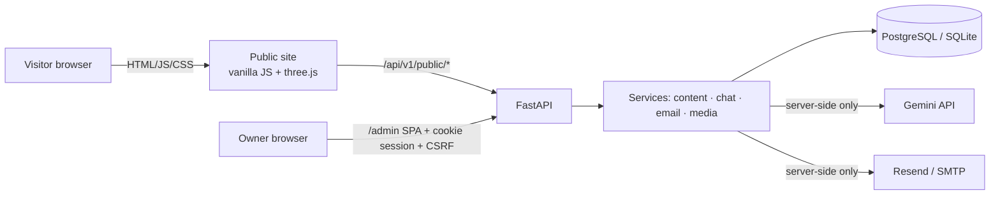

# Architecture

* **One backend, two front ends.** FastAPI serves the JSON API, the public site (`public/`) and the admin SPA (`admin/`) from one origin, so admin cookies are `SameSite=Strict`.
  The public site can alternatively be hosted statically (`vercel-site/`): it reads its bundled `data/site.json` and, if a backend URL is configured, calls the API cross-origin (public endpoints only; no cookies).
* **Content model.** Settings groups (hero, about, design, chatbot, …) are validated JSON documents (`site_settings`); skills, projects and profile items are tables with `published` flags.
  Everything public passes through `content_service`, so drafts cannot leak.
* **Media** is stored in the database (survives redeploys on hosts with ephemeral disks); served from `/media/<random>.<ext>` with `nosniff` and a sandbox CSP.
* **Chatbot.** Chunks are built from *published* content → TF-IDF retrieval (stemming, query-side synonyms) → prompt with fenced untrusted data → Gemini → URL allow-list sanitiser.
  No relevant chunks → fixed "I don't have that" answer without an LLM call. Provider down/not configured → extractive "basic mode" answer. Visitor questions are not stored.
* **Contact.** Validate → honeypot/time/rate-limit → **save to DB** → background email attempt → status recorded (`pending|sent|failed|disabled`). Visitors are told the message was *saved*, never that email was delivered.
* **3D & motion.** `scene.js` (lazy-loaded) draws a neural-network point cloud and a wireframe "AI core"; camera/core move per route and with scroll/pointer. Skipped for reduced-motion, Save-Data, ≤2 CPU cores, no WebGL, or when disabled in admin → CSS gradient backdrop.
  Cards use CSS-3D tilt + cursor spotlight; page changes animate; all motion honours `prefers-reduced-motion` and the admin switches.
* **Routing.** Hash routes (`#/`, `#/projects`, `#/project/<slug>`, `#/contact`…) so static hosting needs no rewrites.

## Data model
`admin_users · site_settings · skills · projects · profile_items(experience|education|certification|achievement) · media_assets · contact_messages · email_attempts · chat_usage_events · audit_logs`

## Decisions
| Decision | Reason | Trade-off |
|---|---|---|
| Cookie session + CSRF embedded in the signed token | HttpOnly cookie not readable by XSS; CSRF bound to session | admin must be same-origin |
| Media bytes in DB | durable on free/ephemeral hosts | DB grows; move to S3/R2 if you upload many large files |
| TF-IDF instead of a vector DB | dozens of chunks; no extra service/cost | revisit if the portfolio grows to hundreds of documents |
| In-memory rate limiters | zero infrastructure | per process; use Redis with several workers |
| three.js vendored in `public/vendor` | no CDN dependency, strict CSP | ~690 KB (lazy-loaded, ~170 KB gzipped) |
